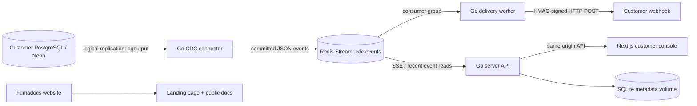

# CDC Lite architecture and repository map

## Architecture at a glance

The customer-facing Docker deployment runs the Go server and Redis. The server owns the packaged frontend, metadata database, pipeline jobs, and webhook delivery loop. PostgreSQL remains the customer's database, not a local container.

## Main folders

| Path | Responsibility |
| --- | --- |
| `worker/cmd/server` | Customer-facing Go server: REST API, static console hosting, CDC pipeline manager, Redis delivery consumer, webhook signing, and health check. |
| `worker/cmd/connector` | Earlier standalone local CDC connector for the small demo workflow. |
| `worker/cmd/delivery` | Earlier standalone local Redis-to-webhook delivery worker. |
| `worker/cmd/metadata` | One-shot SQLite migration/schema/admin metadata command. |
| `worker/internal/replication` | PostgreSQL `pgoutput` protocol decoding, relation cache, event decoding, transaction buffering, and LSN acknowledgement behavior. |
| `worker/internal/redis` | Redis client setup and transaction-order event publishing to `cdc:events`. |
| `worker/internal/metadata` | SQLite schema, migrations, encryption, saved database/pipeline/sink models, and bounded delivery history. |
| `worker/internal/postgres` | PostgreSQL connection helpers and direct replication connection configuration. |
| `worker/internal/config` | Environment-variable configuration for standalone demo processes. |
| `worker/internal/logging` | Structured Go logging setup. |
| `web/` | Customer console: Next.js dashboard for databases, table inspection, pipelines, live events, and sinks. It has no public docs routes. |
| `website/` | Separate public site: landing page at `/` and Fumadocs MDX documentation at `/docs`. |
| `release/docker-compose/` | Customer distribution bundle: Compose file, blank environment template, and offline quick-start README. |
| `sample/source-init.sql` | Sample `users` and `orders` tables with data and `REPLICA IDENTITY FULL`. |
| `sample/receiver/` | Small Go HMAC-validating webhook receiver for local development. |
| `scripts/package-release.ps1` | Produces a clean Compose ZIP and SHA-256 checksum. |

## Important implementation boundaries

CDC Lite is deliberately a small single-installation product. It supports one running pipeline, one Redis stream, sequential delivery, and SQLite for small platform metadata. This keeps the project understandable while still demonstrating real CDC and event-driven engineering concepts.

It is not a multi-tenant SaaS, a managed database product, or an unlimited-scale pipeline engine.
