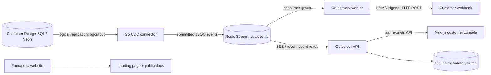

# CDC Lite architecture and repository map

## Architecture at a glance

The customer-facing Docker deployment runs the Go server and Redis. The server owns the packaged frontend, metadata database, pipeline jobs, and webhook delivery loop. PostgreSQL remains the customer's database, not a local container.

## Main folders

| Path | Responsibility |
| --- | --- |
| `worker/cmd/server` | Customer-facing Go server: REST API, static console hosting, CDC pipeline manager, Redis delivery consumer, webhook signing, and health check. |
| `worker/cmd/connector` | Earlier standalone local CDC connector for the small demo workflow. |
| `worker/cmd/delivery` | Earlier standalone local Redis-to-webhook delivery worker. |
| `worker/cmd/metadata` | One-shot SQLite migration/schema/admin metadata command. |
| `worker/internal/replication` | PostgreSQL `pgoutput` protocol decoding, relation cache, event decoding, transaction buffering, and LSN acknowledgement behavior. |
| `worker/internal/redis` | Redis client setup and transaction-order event publishing to `cdc:events`. |
| `worker/internal/metadata` | SQLite schema, migrations, encryption, saved database/pipeline/sink models, and bounded delivery history. |
| `worker/internal/postgres` | PostgreSQL connection helpers and direct replication connection configuration. |
| `worker/internal/config` | Environment-variable configuration for standalone demo processes. |
| `worker/internal/logging` | Structured Go logging setup. |
| `web/` | Customer console: Next.js dashboard for databases, table inspection, pipelines, live events, and sinks. It has no public docs routes. |
| `website/` | Separate public site: landing page at `/` and Fumadocs MDX documentation at `/docs`. |
| `release/docker-compose/` | Customer distribution bundle: Compose file, blank environment template, and offline quick-start README. |
| `sample/source-init.sql` | Sample `users` and `orders` tables with data and `REPLICA IDENTITY FULL`. |
| `sample/receiver/` | Small Go HMAC-validating webhook receiver for local development. |
| `scripts/package-release.ps1` | Produces a clean Compose ZIP and SHA-256 checksum. |

## Important implementation boundaries

CDC Lite is deliberately a small single-installation product. It supports one running pipeline, one Redis stream, sequential delivery, and SQLite for small platform metadata. This keeps the project understandable while still demonstrating real CDC and event-driven engineering concepts.

It is not a multi-tenant SaaS, a managed database product, or an unlimited-scale pipeline engine.

## Runtime components in detail

### `cdc-lite-server`

This is the main customer-facing runtime. Its executable begins at `worker/cmd/server/main.go`.

- It embeds the built `web/` files in the Go binary using `//go:embed`, so the server can serve the console and API from one port.
- `run()` creates a signal-aware root context, opens SQLite, applies migrations, recovers interrupted pipeline statuses, bootstraps the first administrator, opens Redis, creates the `app` struct, and starts both HTTP serving and the delivery loop.
- `app` holds the four shared dependencies: `metadata.Store`, Redis client, structured logger, and `pipelineManager`.
- `pipelineManager` is deliberately an in-memory map from pipeline ID to `context.CancelFunc`. It controls the one active replication job for this student release.
- `routes()` is the API routing table. It maps every browser request to a small handler, then passes non-API paths to `static()` for the embedded Next.js files.

### PostgreSQL source database

The source database is external to CDC Lite. It owns WAL, publication records, replication slots, and the actual business tables. CDC Lite uses two connections:

1. A normal pgx SQL connection for prerequisite checks, table inspection, publication creation, and metadata queries.
2. A second replication-protocol connection with `replication=database` appended to the connection URL. This connection receives raw `CopyData` frames containing `pgoutput` messages.

### Redis

Redis is the transport buffer, not the source of truth for pipeline configuration. `cdc:events` contains fields such as `event_id`, table, operation, commit LSN, JSON payload, and `pipeline_id`. The pipeline ID prevents a sink from receiving events from a different pipeline.

The `server-delivery` consumer group tracks delivery progress. A message is acknowledged only after all enabled matching sinks return success.

### SQLite metadata database

SQLite is the control-plane store in `/data/cdc-lite.db`. It survives server restarts through the Docker volume. The database uses foreign keys, WAL mode, a busy timeout, and one connection because this is a small single-server installation.

It stores *configuration and observable history*, not live WAL messages: administrator record, encrypted source URLs, pipeline table selections, sink settings, and safe delivery-attempt metadata.

### Customer console (`web/`)

The console is a Next.js App Router application compiled to static files for the packaged server. The browser calls same-origin `/api/*` endpoints served by Go. Important client components are:

- `databases.tsx`: add/test/save/edit/delete database connections.
- `database-browser.tsx`: load schemas/tables, inspect metadata, preview rows, and manage pipelines.
- `event-list.tsx`: initial event fetch plus `EventSource` for live updates.
- `sinks.tsx`: create/review sinks, enable/disable them, send test events, and show health/history.
- `overview.tsx`: polls a small overview endpoint for counts.

The legacy `web/app/api` routes are useful for the local standalone dashboard workflow. The packaged customer server owns the equivalent same-origin APIs in Go.

### Public site (`website/`)

This is intentionally separate from the customer console. It has its own `package.json`, Next.js runtime, Fumadocs MDX source, and routes. It provides a portfolio landing page at `/` and public documentation at `/docs`; it does not contain customer credentials or operate CDC jobs.
