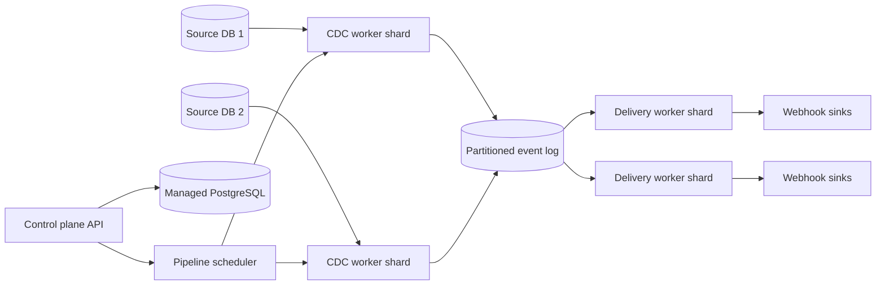

# Scaling Walflow to millions of users: an honest roadmap

## First: what “millions” means

The current application is **not** designed for millions of users, databases, or events per second. It deliberately supports one active pipeline and sequential delivery. Claiming otherwise in an interview would be incorrect.

The value of this project is that its boundaries are explicit, so a realistic evolution path is clear.

## Stage 1: scale one installation to many pipelines

Before global scale, remove the single-process limits:

1. Move metadata from SQLite to managed PostgreSQL so multiple API/job processes can safely update it.
2. Replace one in-memory pipeline manager with a persisted job scheduler.
3. Assign each pipeline to a worker using leases and fencing tokens, preventing two workers from consuming the same replication slot.
4. Run multiple CDC worker replicas, each owning a partition of pipeline IDs.
5. Use one Redis Stream per pipeline or a partitioned stream namespace to prevent one noisy source from delaying unrelated sources.
6. Add configurable concurrency limits per sink while preserving per-pipeline ordering when customers require it.

## Stage 2: scale the event backbone

Redis Streams can be suitable for modest throughput, but a large multi-tenant system may need a partitioned durable log such as Kafka, Redpanda, Pulsar, or a managed equivalent.

Key design rules:

- Partition by pipeline/source ID so ordering is maintained within a source while allowing parallelism between sources.
- Keep a durable source offset/checkpoint after the event log confirms persistence.
- Give every event a globally stable ID and keep downstream delivery idempotent.
- Separate ingest, storage, and delivery autoscaling signals: replication lag, log lag, and webhook latency are different problems.

## Stage 3: scale webhook delivery safely

At scale, webhook endpoints are often the slowest and least reliable component.

- Use a delivery queue partitioned by sink or endpoint.
- Add bounded exponential backoff with jitter and an explicit retry policy.
- Add a dead-letter queue after a documented maximum number of attempts.
- Apply endpoint-level rate limits and circuit breakers so one unhealthy endpoint does not exhaust workers.
- Record delivery attempts in an append-only analytics store or time-partitioned database rather than the control-plane database.
- Keep payload retention and replay policies explicit because they have security and cost implications.

## Stage 4: turn it into a secure multi-tenant product

For millions of users, add product concerns that are intentionally absent today:

- Real authentication, organizations, roles, audit logs, billing, and quotas.
- A secret manager/KMS with envelope encryption and key rotation.
- Tenant isolation in databases, streams, worker pools, logs, and rate limits.
- Stronger SSRF defenses, allowlists, egress proxying, and destination verification.
- Regional deployment strategy and data-residency controls.
- SLOs, metrics, tracing, alerts, backups, disaster recovery, and operational runbooks.

## Capacity thinking to explain in an interview

Do not begin with “millions of users”; begin with measurable units:

- Active pipelines.
- Transactions/events per second per source.
- Average event size.
- Redis/log retention duration.
- Webhook latency and success rate.
- Number of delivery attempts per event.

For example, if an average event is 2 KB and the system ingests 10,000 events/second, raw ingress is roughly 20 MB/second before replication, retries, and retention. This immediately drives partition count, network capacity, storage throughput, and cost decisions.

## What remains unchanged at scale

The core reliability rule remains the same: persist an event durably before advancing the PostgreSQL replication checkpoint. Exact technologies can change, but this invariant prevents acknowledged-but-lost source changes.
