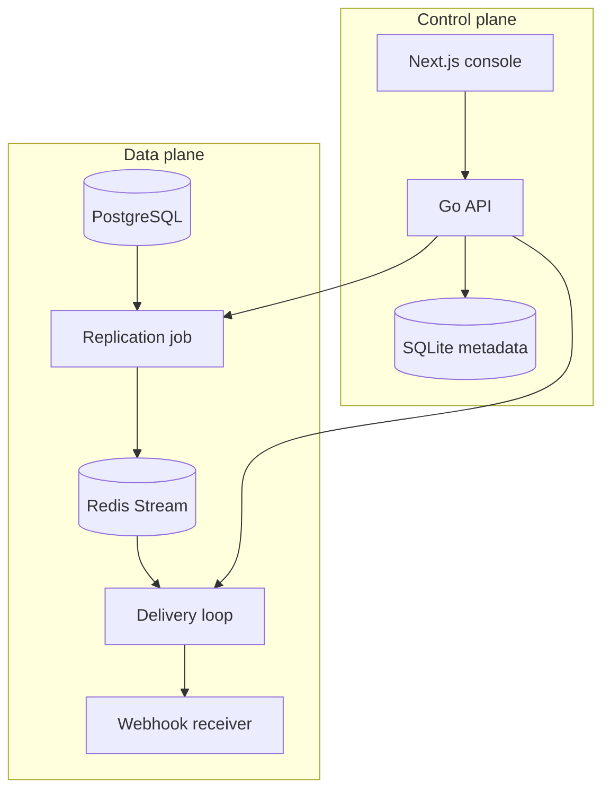

# CDC Lite system design

## Functional requirements implemented

- Connect a PostgreSQL source database using a customer-supplied URL.
- Verify CDC compatibility rather than silently falling back to polling.
- Select source tables and stream committed row changes.
- Buffer events in Redis.
- Send signed webhooks and show delivery outcomes.
- Display live events and basic operational state in a browser.

## Data plane vs control plane

The control plane stores desired configuration: sources, selected tables, pipelines, sinks, and historical status. The data plane moves actual change events. Separating these ideas prevents transient runtime state from being the only record of a pipeline.

## Delivery semantics

CDC Lite provides **at-least-once** delivery, not exactly-once.

1. A PostgreSQL transaction commits.
2. CDC Lite publishes its decoded events to Redis.
3. CDC Lite acknowledges the PostgreSQL LSN only after the Redis write succeeds.
4. The delivery loop sends each event and acknowledges the Redis message after receiving a 2xx HTTP response.

If any process stops between these stages, an event can be retried. Stable event IDs provide the receiver with the information needed for idempotency.

## Main data model

| Entity | Purpose |
| --- | --- |
| `administrators` | One password-hashed local administrator record. |
| `source_connections` | Display name, encrypted PostgreSQL URL, test state, safe error. |
| `pipelines` | Source connection, publication/slot names, selected tables, state, safe error. |
| `pipeline_tables` | Many selected schema/table pairs for a pipeline. |
| `sinks` | Pipeline-specific Webhook sink, encrypted signing secret, enabled state, recent status. |
| `delivery_attempts` | Bounded safe delivery history without payloads or secrets. |

## Failure handling

| Failure | Current behavior |
| --- | --- |
| PostgreSQL connection/prerequisite failure | Marks pipeline failed with an actionable safe error; does not poll. |
| Redis publish failure | Does not acknowledge the related PostgreSQL LSN. |
| Webhook non-2xx / network failure | Records failure and leaves stream entry pending. |
| Server restart | Stops in-memory jobs safely; saved pipeline configuration remains in SQLite. |
| Webhook destination points internally | Rejects loopback, private, link-local, cloud-metadata, redirects, and unsafe DNS resolution. |

## Why these choices fit the project

The goal was to demonstrate robust ideas without pretending to be an enterprise product. Redis Streams gives a durable local buffer with low operational complexity. SQLite avoids adding another database solely for small control-plane metadata. A single Go service keeps the Compose deployment understandable for a student project and self-hosted demo.
