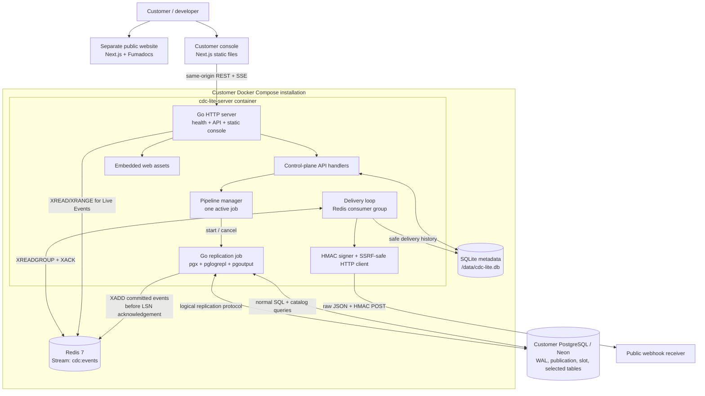
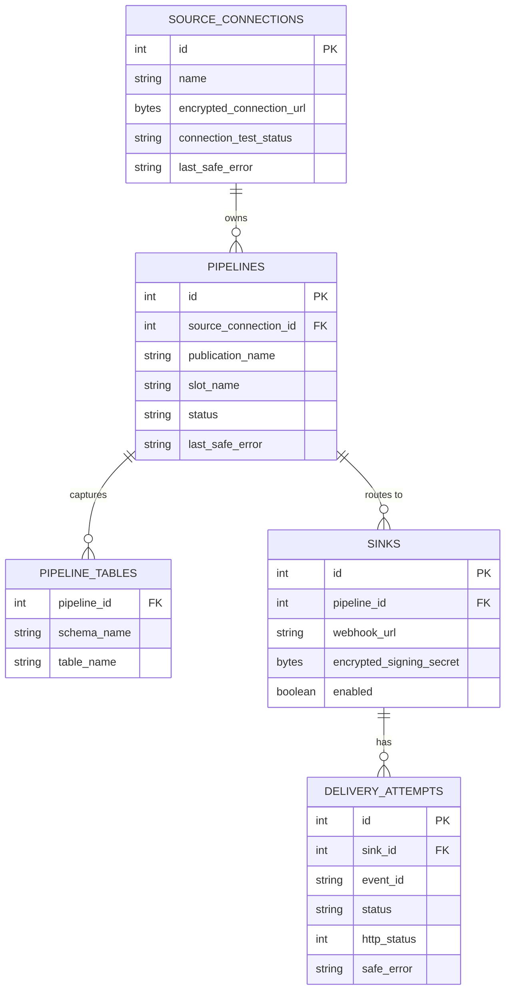
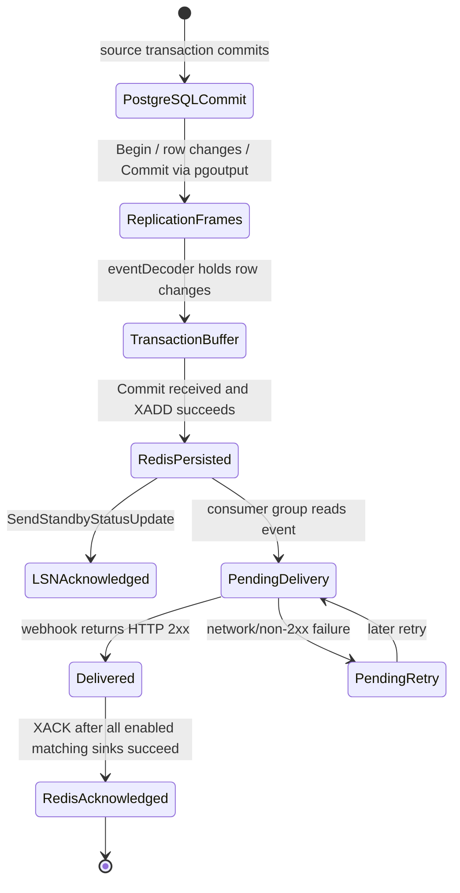

# CDC Lite system design

## The complete system



## Two separate frontends

| Application | Folder | Audience | Role |
| --- | --- | --- | --- |
| Customer console | `web/` | Customer operating CDC Lite | Manages sources, pipelines, sinks, events, and health. Its static output is embedded in the Go server. |
| Public website | `website/` | Recruiter/developer/public user | Landing page and Fumadocs documentation. It does not access customer sources or metadata. |

The separation is intentional: customer operations are private and self-hosted; public documentation can be deployed independently.

## Control plane in detail

The **control plane** answers: *what source should be captured, which tables, which sink, and what is the desired/current configuration state?* It does not carry every change row. SQLite is its source of truth.



### Control-plane jobs

1. Receive browser configuration requests through Go HTTP handlers.
2. Test normal PostgreSQL access separately from CDC requirements.
3. Encrypt secrets before storage; decrypt them only for an in-memory operation.
4. Validate selected tables before pipeline creation.
5. Persist pipeline configuration before starting a replication goroutine.
6. Expose read-only source inspection and safe operational history.
7. Keep pipeline/sink configuration after a process restart even though running goroutines disappear.

`pipelineManager` is a small control-plane runtime helper. Its map stores only cancellation functions for currently running jobs. SQLite is still the durable record. On startup `MarkInterruptedPipelinesStopped` corrects statuses because an old in-memory job cannot survive a process restart.

## Data plane in detail

The **data plane** answers: *how does one committed database row change reach the right webhook safely?* Its components are PostgreSQL WAL, the Go replication job, Redis Stream, the delivery loop, and the destination.



### Central reliability invariant

**CDC Lite must persist the committed event in Redis before acknowledging the related PostgreSQL LSN.**

If PostgreSQL were acknowledged first, a crash between acknowledgement and Redis write could lose a source event permanently. The implemented order can instead produce a duplicate after a crash/reconnect. That is intentional **at-least-once delivery**. Stable IDs (`commit_lsn:sequence`) let a receiver deduplicate.

## End-to-end request and event paths

### Create a pipeline

```text
Console POST /api/databases/{id}/pipelines
  → createPipeline()
  → validatePipelineTables() [read-only PostgreSQL check]
  → pipelineNames()
  → SQLite CreatePipeline()
  → launchPipeline()
  → postgres.Connect()
  → replication.Run() goroutine
  → PostgreSQL ensurePublication() + ensureSlot()
```

### Process a source row

```text
PostgreSQL COMMIT
  → readMessages()
  → ParseXLogData() + pglogrepl.Parse()
  → eventDecoder.Process()
  → StreamPublisher.Publish()
  → Redis XADD cdc:events
  → acknowledgeCommit(LSN)
  → deliveryLoop() XREADGROUP
  → EnabledSinksForPipeline(pipelineID)
  → deliverWebhook()
  → RecordDeliveryAttempt()
  → Redis XACK after success
```

### Live browser updates

```text
EventList → GET /api/events [recent snapshot]
EventList → EventSource /api/events/stream
server.stream() → Redis XREAD
server.stream() → SSE event: cdc
EventList updates list and applies table/operation filters in browser
```

## Failure boundaries

| Boundary | Failure outcome |
| --- | --- |
| Source → replication job | Connection or permissions failure marks the pipeline with a safe error; there is no polling fallback. |
| Replication job → Redis | Redis publish failure prevents LSN acknowledgement, allowing source replay. |
| Redis → webhook | Failure is recorded; stream message remains unacknowledged/pending. |
| Webhook endpoint | SSRF checks reject unsafe addresses/redirects; only HTTP 2xx succeeds. |
| Process restart | Configuration/history stays in SQLite; runtime jobs are safely marked stopped and require explicit start. |

## Current deployment limitation

One server process, SQLite, and the in-memory pipeline manager mean this topology is intentionally single-installation and single-active-pipeline. It is a correct small architecture, not a horizontally replicated multi-tenant service. See [the scaling roadmap](SCALING_TO_MILLIONS.md) for the design changes required to remove those limits.
